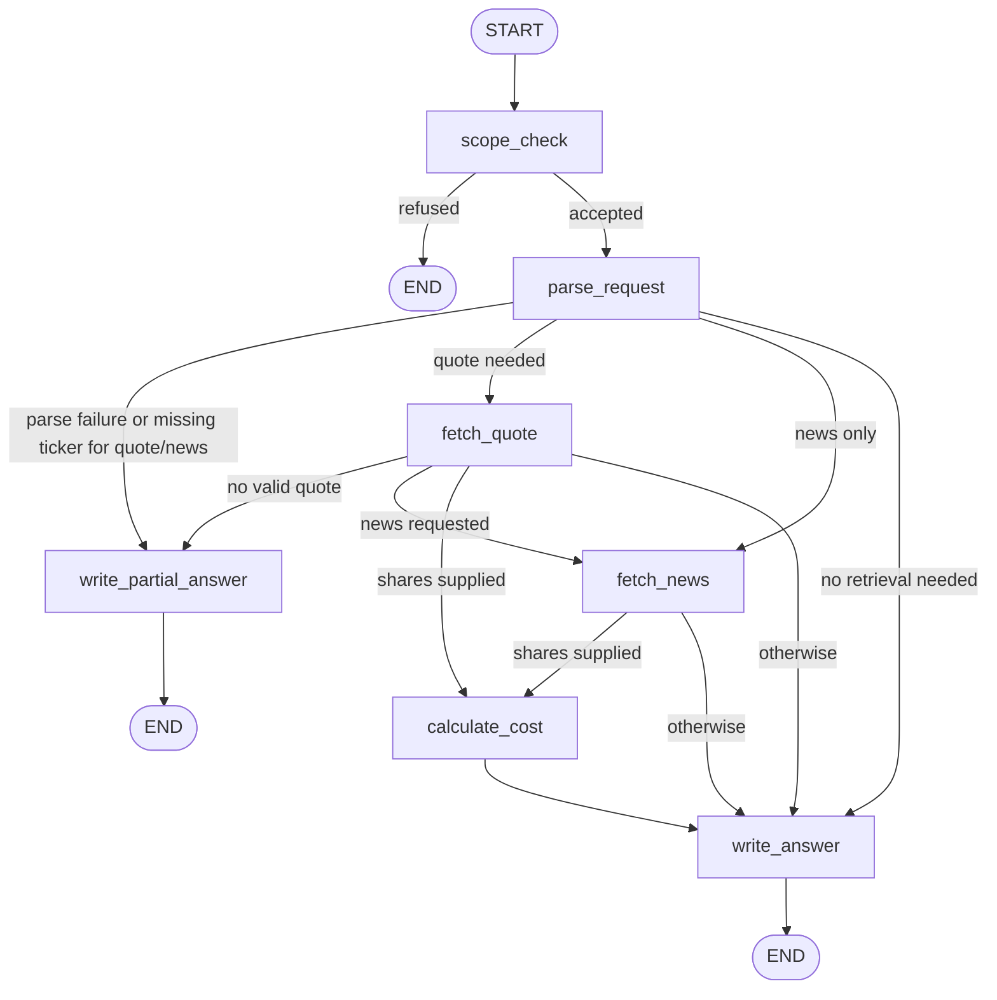

# Market Research Assistant

A command-line application for sourced, informational equity-market research. It retrieves the latest available closing prices, searches recent news, calculates estimated share costs, and presents the result with sources, timestamps, freshness information, and an investment-advice disclaimer.


## What it does

- Interprets one or more ticker symbols and an optional share quantity from a natural-language question.
- Retrieves the latest available closing price from Yahoo Finance through `yfinance`.
- Searches finance news through Tavily, preferring the past day and falling back to the past week when results are sparse.
- Retrieves relevant stable reference context from the local RAG knowledge base when a question asks for company or industry background.
- Calculates share costs deterministically in Python.
- Labels price type, trading date, retrieval time, source, and freshness.
- Separates verified quote data from reported news and model-written summaries.
- Refuses trade execution, unrelated requests, and personalized investment-advice requests.
- Streams workflow progress and answer text in the terminal.

## Architecture

```text
CLI question
  ↓
LangGraph workflow
  ↓
scope check → structured parsing → quote/news retrieval → calculation → answer
  ↓
terminal progress updates + streamed answer text
```

The graph coordinates the work. External retrieval, RAG retrieval, and arithmetic remain ordinary Python functions, independent of the language model.

The current RAG path is a predictable two-step flow:

```text
Question → retrieve relevant reference chunks → grounded answer
```

The knowledge base is stored in `knowledge/` as Markdown with YAML frontmatter and PDFs with YAML sidecars. The retriever uses local embeddings and a persistent Chroma vector store. By default, the index is stored in `.rag_index/`; set `RAG_INDEX_DIR` to use another local directory. A manifest hashes the source chunks, metadata, chunking settings, embedding identity, and index version, so the index is reused across CLI runs and rebuilt when its inputs change.

Retrieval combines up to 20 vector candidates with up to 20 BM25 keyword candidates, using reciprocal rank fusion to return at most two passages. Keyword ranks have twice the weight of vector ranks. The cosine threshold of 0.45 applies to vector candidates; keyword matches can recover passages missed by vector search. These scores rank evidence and are not probabilities that an answer is correct. Keyword scoring scans the loaded chunks locally, which suits the current small corpus.

Both searches filter by ticker, retaining generic untickered documents. An explicit annual-report/10-K reference adds a document-type filter; a single year in that request also filters `document_version` (annual-report sidecars should use the report year there). Within that scope, the search focuses on the topic rather than repeating company and report identifiers. PDF loading strips repeated margin lines, and each selected PDF chunk includes at most one neighboring chunk on either side from the same page. References display the PDF page number, which can differ from the report's printed page number.

Company documents declare metadata explicitly:

```yaml
---
ticker: AAPL
company: Apple Inc.
document_type: company_overview
source_url: https://investor.apple.com/
source_name: Apple Investor Relations
last_reviewed: 2026-09-26
document_version: "1.1"
---
```



## Technology

- Python 3.11+
- LangGraph
- LangChain Core and `langchain-openai`
- `langchain-text-splitters`, `langchain-huggingface`, and `langchain-chroma`
- `pypdf` for page-level PDF text extraction
- `sentence-transformers` for local document embeddings
- `PyYAML` for knowledge-document frontmatter
- An OpenAI-compatible model endpoint (currently configured for OpenCode Go)
- `yfinance`
- Tavily
- `python-dotenv`

## Setup

Create and activate a virtual environment, then install the project in editable mode:

```bash
python3.12 -m venv .venv
source .venv/bin/activate
pip install -e .
```

Create a `.env` file in the project root. Never commit this file.

```dotenv
TAVILY_API_KEY=your_tavily_key
OPENCODE_API_KEY=your_opencode_key
OPENCODE_BASE_URL=https://opencode.ai/zen/go/v1
OPENCODE_MODEL=deepseek-v4-flash
```

The model endpoint and model name are configurable so the application can later use another compatible provider without changing workflow code.

## Usage

After installation, run either form:

```bash
market-research "What was the latest available closing price of NVDA, how much would 8 shares cost, and what recent news was reported?"
```

```bash
python -m market_research.cli "Compare AAPL and MSFT prices."
```

Running `market-research` with no question starts an interactive prompt.

Prepare the local RAG index explicitly with:

```bash
market-research-index
```

The equivalent module command is:

```bash
python -m market_research.ingest
```

Download the latest available Apple annual report automatically:

```bash
market-research-fetch --ticker AAPL
```

The current Apple source adapter tries recent official investor-relations
annual-report PDFs and writes both the PDF and a validated YAML sidecar under
`knowledge/raw/apple/`. To fetch a specific year, use `--year`, and use
`--force` to replace an existing local copy:

```bash
market-research-fetch --ticker AAPL --year 2025
market-research-fetch --ticker AAPL --year 2025 --force
```

After downloading a report, refresh the persistent index:

```bash
market-research-index --force
```

The downloader is intentionally source-specific for now. Apple is the first
adapter; other issuers can be added without changing the PDF loader.

Use `--force` or `--force-rebuild` to rebuild even when the existing index is current. You can override the source and output locations with `--knowledge-dir` and `--index-dir`. Research queries still check the index automatically, so explicit ingestion is optional but useful when preparing a deployment or verifying the knowledge base.

PDF files can be placed anywhere below the knowledge directory. Each PDF requires a same-named YAML sidecar because PDFs do not contain the project’s frontmatter format:

```text
knowledge/raw/apple/annual_report_2025.pdf
knowledge/raw/apple/annual_report_2025.yaml
```

Example sidecar:

```yaml
ticker: AAPL
company: Apple Inc.
document_type: annual_report
source_name: Apple Investor Relations
source_url: https://example.com/apple-report.pdf
published_date: 2025-10-31
last_reviewed: 2026-09-26
document_version: "2025"
```

The loader creates one document per non-empty PDF page and preserves `page_number`, `page_count`, `source`, and `source_format` metadata. Run `market-research-index --force` after adding or changing a PDF. Scanned image-only PDFs are not supported yet because they require OCR.

## Output design

Python renders predictable, data-sensitive sections:

- Summary
- Quotes
- Estimated share cost, when shares are requested
- Recent news and source links
- Reference sources, when RAG context is used
- Data limitations
- Disclaimer

The language model writes only the narrative summary and news summaries. Quotes, sources, arithmetic, timestamps, and disclaimers are rendered by application code. News excerpts are treated as untrusted data and explicitly delimited in the model prompt; instructions inside articles are ignored.

## Testing

Run the test suite with:

```bash
python -m pytest -q
```

External services are mocked in the normal tests, so they are fast, deterministic, and do not consume Yahoo, Tavily, or model API requests.

The RAG tests also include deterministic evaluation cases for Apple, Microsoft, methodology questions, keyword recovery when vector search misses the answer, company/year filtering, PDF margin cleanup, adjacent context, and PDF page references.

To measure retrieval with the real embedding model and current documents:

```bash
python -m market_research.evaluate
```

This evaluates ten labelled questions without calling the answer model or market
data APIs. Results and retrieved evidence are saved to the Git-ignored
`evaluations/results/latest.json`. See [the evaluation guide](evaluations/README.md)
for metrics and known baseline failures. It checks retrieval directly; it does
not evaluate request parsing or final-answer quality.

To generate final answers for the three evidence-sufficiency cases and prepare
a human review, run:

```bash
python -m market_research.evaluate_answers
```

This calls your configured OpenCode model. It saves actual answers, evidence,
and automated review signals to `evaluations/results/answers_latest.json`, plus
a readable `answers_latest.md` review checklist. Automated signals are not
correctness grades; review the full answers against their evidence. See the
[evaluation guide](evaluations/README.md#final-answer-evaluation) for details.

## Current limitations

- Prices are latest available closes, not guaranteed live prices.
- Yahoo Finance and Tavily data can be delayed, incomplete, or unavailable.
- The initial RAG corpus is small and local; automated downloading and refreshing of official filings are future work.
- Hugging Face authentication is currently optional; configure `HF_TOKEN` later
  if higher rate limits or more reliable embedding-model downloads are needed.
- The first version has no portfolios, trade execution, database, dashboard, or conversation memory.
- The assistant does not provide personalized buy/sell recommendations. (YET)
